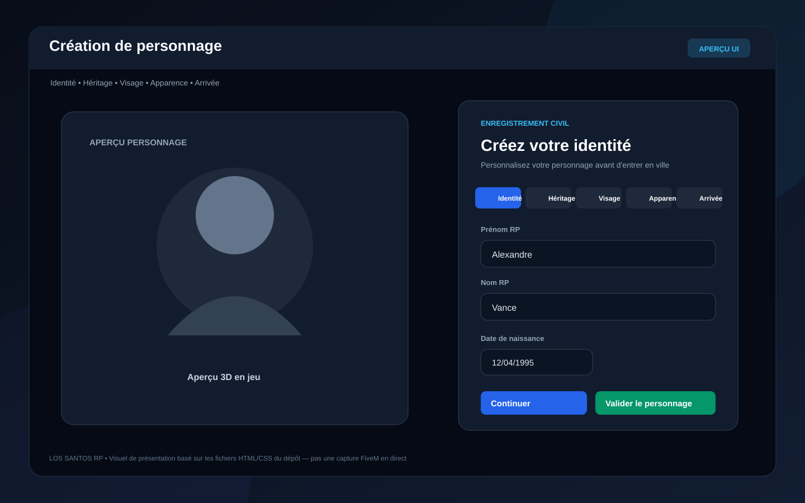
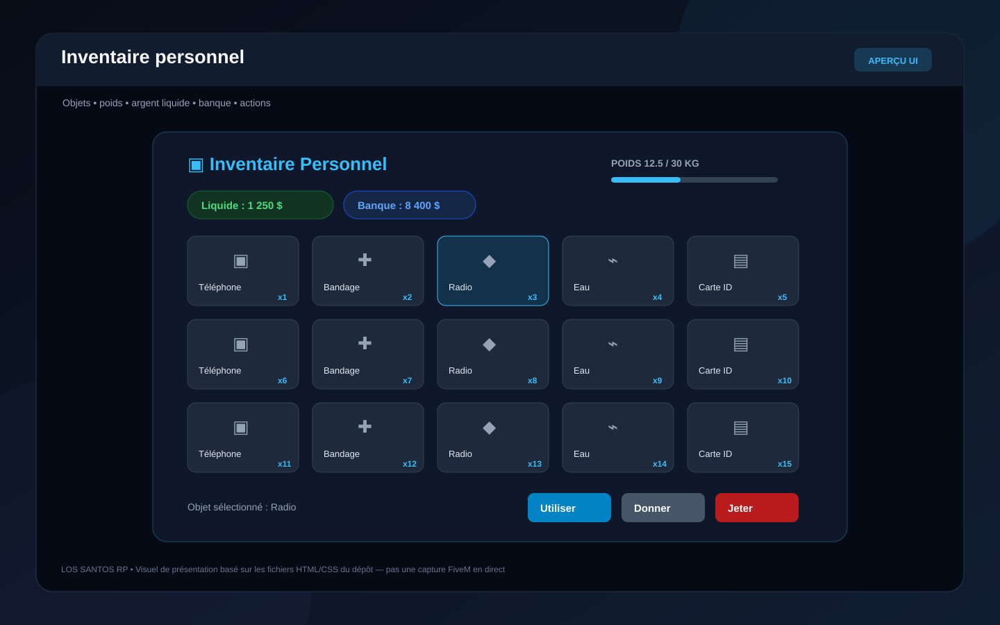
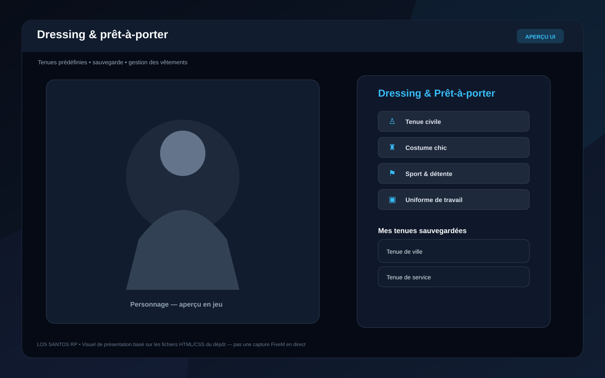
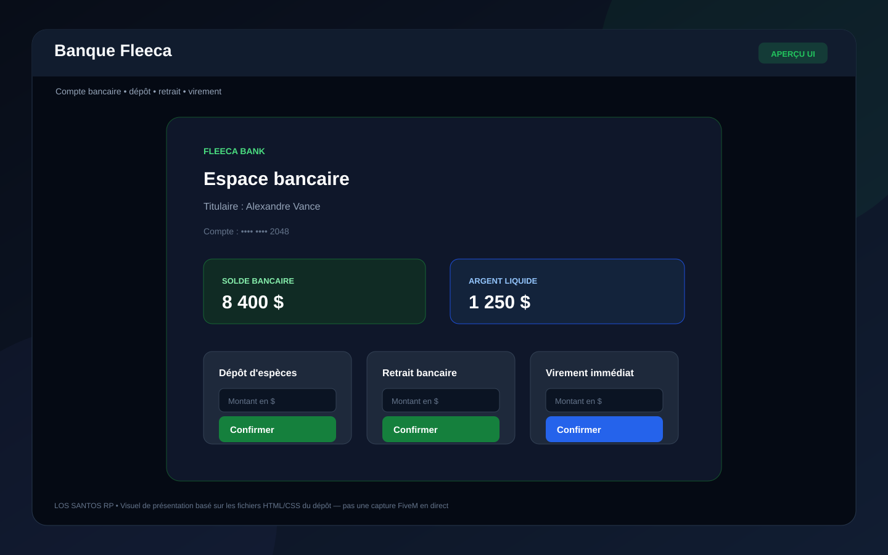
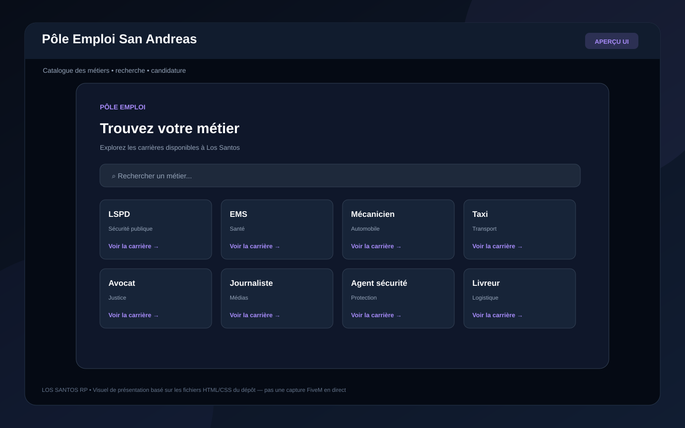
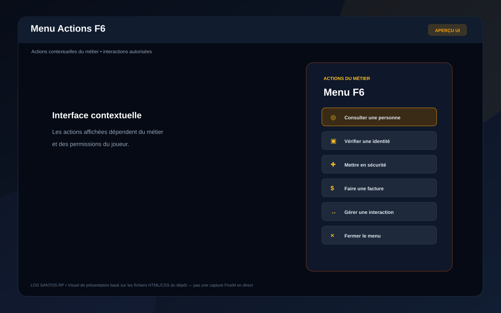
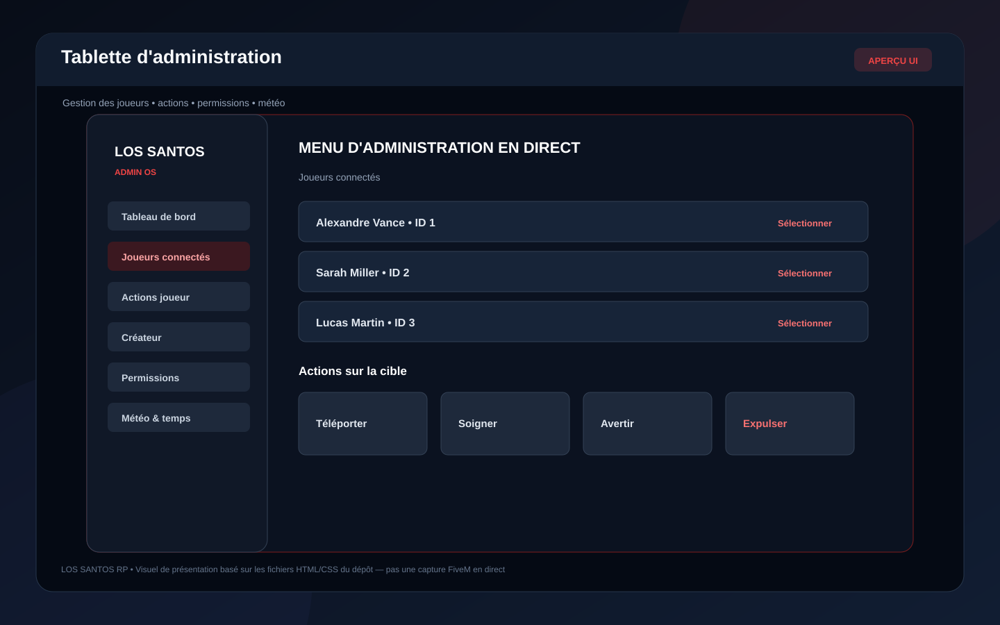
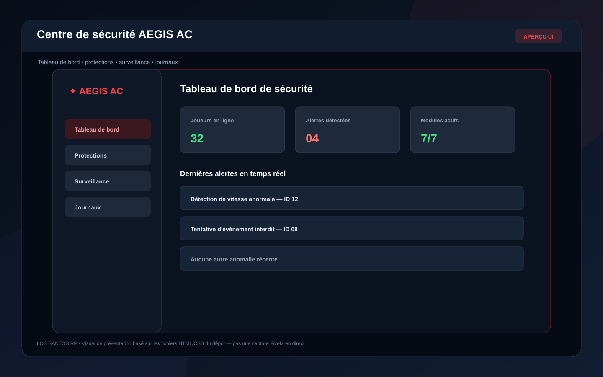
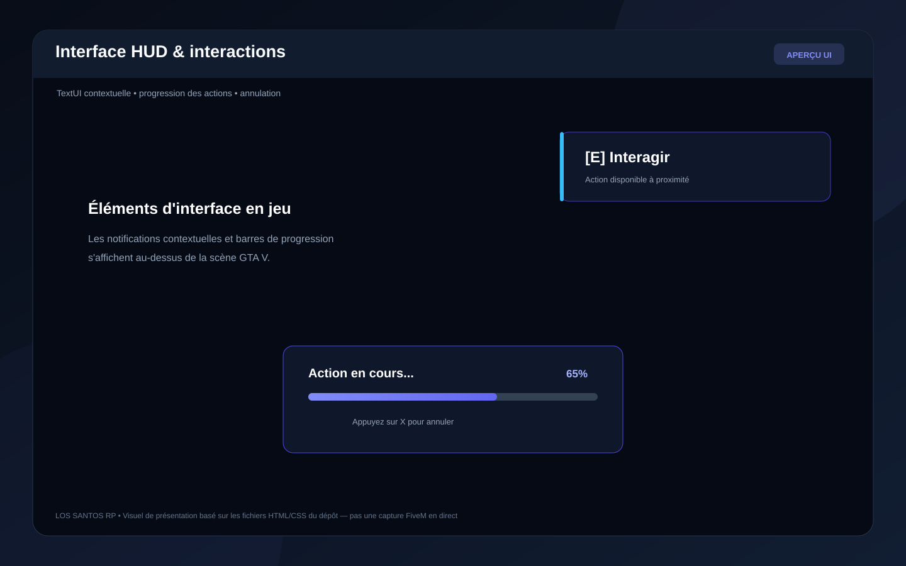
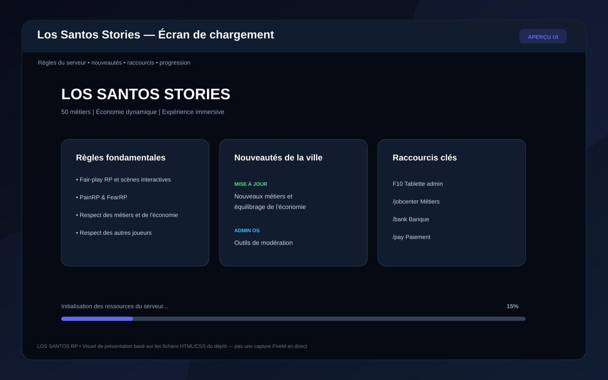

# Catalogue des interfaces — Los Santos RP

Ce dossier regroupe les aperçus visuels des interfaces NUI repérées dans le dépôt. Les SVG sont des **maquettes de présentation reconstituées à partir des fichiers HTML/CSS** : ce ne sont pas des captures d'écran prises en session FiveM.

## Menus et interfaces

### 1. Création de personnage

### 2. Inventaire personnel

### 3. Dressing et vêtements

### 4. Banque Fleeca

### 5. Pôle Emploi — catalogue des métiers

### 6. Menu Actions F6

### 7. Tablette d'administration

### 8. Centre de sécurité / anti-cheat

### 9. HUD — TextUI et progression

### 10. Écran de chargement

## Visuels déjà présents dans le dépôt

- [Créateur — aperçu graphique existant](../previews/menu_createur_noir_bleu.png)
- [Administration — aperçu graphique existant](../previews/menu_admin_noir_rouge.png)

## Périmètre

Les dix interfaces listées correspondent aux ressources qui possèdent actuellement une page NUI HTML dans le dépôt. Le système criminel ajouté récemment n'a pas encore de menu NUI dédié : ses interactions utilisent pour l'instant des touches et commandes. Il n'est donc pas présenté comme un menu déjà existant.

Pour produire des captures authentiques, il faudra lancer FXServer, ouvrir chaque interface en jeu et capturer le rendu NUI final.
